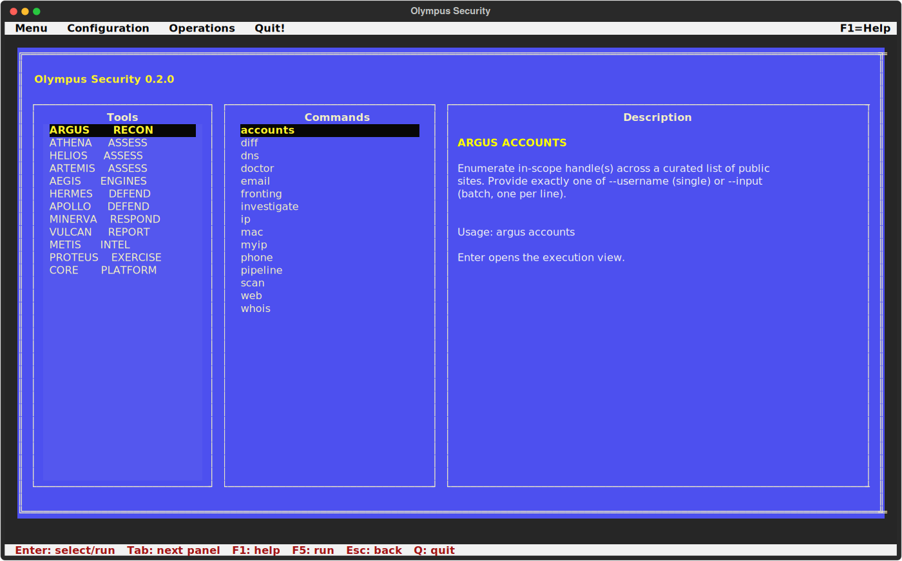

# Olympus terminal interface

`olympus ui` is the keyboard-first interface for the complete Olympus command
tree. It uses the same Typer/Click objects as the CLI, so newly registered tools
and leaf commands appear without maintaining a second execution catalogue.

## Operation

- **Arrow keys** select tools and commands.
- **Tab** moves between the tool and command panes.
- **Enter** opens the selected command.
- **F5** runs it with the arguments entered in the execution view.
- **Ctrl+C** requests termination of the child process.
- **Escape** returns to the command browser when no process is running.
- **F1** opens the help screen and **F10** returns focus to the tool menu.

The execution view launches `python -m olympus.cli` with a fixed argument
vector and no shell. Standard output and error stream into a bounded log; the
real process exit code remains visible. The TUI therefore does not reinterpret
results or replace the CLI's machine-readable outputs.

## Security boundary

The interface cannot bypass authorization, scope, SSRF, deadline, cancellation
or resource-limit controls. Commands that require `--scope` and
`--i-am-authorized` still require those arguments. Secrets remain environment
variables and should never be pasted into the argument field.

The palette follows the supplied Norton Utilities reference: blue work area,
ivory borders, black/yellow selection, white menu strip and red status text. A
true-colour terminal is recommended. Environments that deliberately set
`NO_COLOR` receive a readable grayscale fallback.

## Dynamic forms derived from the CLI (`UX-A`)

A guided form must not be a single free-text argument box. `olympus.cli_forms`
derives, from the real Typer/Click command tree, an **interface-agnostic** form
schema so a TUI and a future web UI render the *same* fields instead of each
re-deriving the CLI's shape (`UX-A` bullet 4):

- `form_for("themis scan")` returns a `CommandForm` whose `fields` are typed
  `FormField`s — one per option/argument — each with a `kind` (`text`,
  `integer`, `number`, `boolean`, `choice`, `path`), its `required` flag, a
  stable `default`, `choices` (from enums), numeric `minimum`/`maximum` (from
  Click ranges), the `multiple` (repeatable) flag and the help text. So a UI
  knows to draw a checkbox, a select, a path picker or a ranged number input
  rather than a text box.
- `forms_for_app()` returns the schema for every runnable command, sorted and
  deterministic.
- `validate_values(form, values)` validates entered values **locally, before any
  run**: missing required fields, values outside a choice set, non-numeric input
  for a numeric field, and out-of-range numbers — returning human-readable errors.
- Defaults that are computed/absolute paths are omitted (no machine-specific
  value leaks into the schema), the same determinism discipline as the CLI
  reference.

### Guided form in the execution view

The execution screen renders this schema as live Textual widgets instead of a
single argument box:

- a **checkbox** for each boolean flag, a **select** for each choice (enum), and
  a typed **input** for text / integer / number / path fields (the placeholder
  shows the range and default; a path is a validated text input, not a modal file
  browser). Repeatable options take space-separated values.
- Required fields are marked with `*`. Pressing **F5** first runs
  `validate_values` locally; if anything is invalid the run is **blocked** with
  the errors and no subprocess is started.
- The entered values are turned into a safe `argv` list — `--flag value` pairs (a
  boolean only when enabled, positionals as bare values in declaration order),
  **never** a shell string — and the exact `olympus …` invocation is printed
  before it runs.
- A **Raw arguments mode (expert)** checkbox keeps the original free-text path:
  when enabled the typed fields are ignored and the string is split with
  `shlex.split` (still no shell). A command with no options shows only this box.
- **Proportionate confirmation (`UX-B`):** when the invocation about to run
  includes the authorization flag `--i-am-authorized` — the product's universal
  gate for a real authorized active operation, in guided or raw mode — the TUI
  first opens a confirmation modal naming the exact invocation and the target, and
  starts the process only after you confirm. Passive and local commands (no
  authorization gate) run with no extra friction.
- **Kill switch and distinct outcome states (`UX-B`):** the **CANCEL** button and
  `Ctrl+C` are always available while a command runs; cancelling terminates the
  process and, if it ignores the signal, force-kills it after a short grace
  period, reporting *Cancelled — the process was terminated* (never a misleading
  "success"). When a run finishes, its canonical exit code
  (`olympus.core.exit_codes`, shared by every command) is shown as a distinct,
  colour-coded state — success, findings, usage error, blocked (out of scope),
  refused, **partial (coverage incomplete, not exhaustive)**, failed or
  cancelled — so a partial or failed run is never read as "no vulnerabilities".

Both the guided form and the raw mode consume the same `cli_forms` schema, so the
TUI and a future web UI stay in lockstep with the CLI. See
[`ROADMAP.md`](../ROADMAP.md) under `UX-A`.
